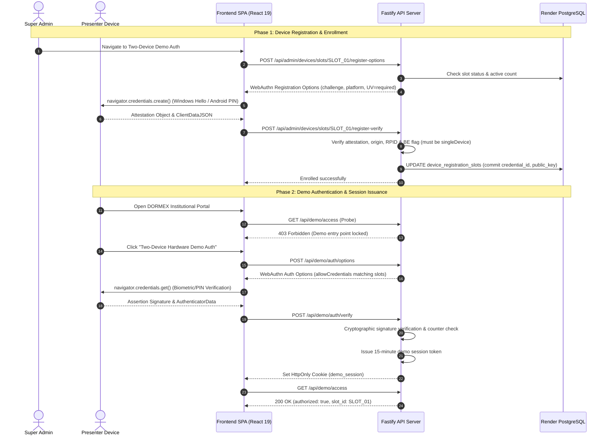

# DORMEX — Exact Two-Device WebAuthn Demo Authentication Specification

**Standard:** W3C Web Authentication Level 3 (WebAuthn L3)  
**Implementation:** `@simplewebauthn/server` (v14.1.0) & `@simplewebauthn/browser` (v14.0.0)  
**Security Boundary:** Hardware-bound Platform Authenticators (Zero-Trust Backup Rejection)  
**Slots:** Exactly Two Predefined Slots (`SLOT_01` & `SLOT_02`)

---

## 1. Architecture & Design Rationale

DORMEX provides a high-security, hardware-bound demo access tier designed to prevent unauthorized multi-device replication and token theft while enabling a smooth, authentic showcase of the allocation platform on dedicated presentation hardware:

1. **`SLOT_01`**: Windows Laptop running Chrome or Edge (backed by TPM 2.0 and Windows Hello PIN/Biometrics).
2. **`SLOT_02`**: Android Phone running Chrome or Edge (backed by Android Keystore / StrongBox hardware).

### A. Strict Two-Device Invariant
- **Database Level Constraint**: Table `device_registration_slots` restricts `slot_id` to `('SLOT_01', 'SLOT_02')` via `CHECK (slot_id IN ('SLOT_01', 'SLOT_02'))`.
- **Unique Partial Index**: `CREATE UNIQUE INDEX idx_device_slots_active_cred ON device_registration_slots (credential_id) WHERE credential_id IS NOT NULL AND is_revoked = FALSE;`
- **Application Level Locking**: All registration ceremonies run inside `BEGIN ... SELECT ... FOR UPDATE;` transactions that check existing active count (`COUNT(*) < 2`) before writing. A third active registration is physically impossible.

### B. Single-Device Credential Invariant (Rejection of Synced Passkeys)
- Standard WebAuthn passkeys synchronized across cloud ecosystems (Google Password Manager, iCloud Keychain) are **rejected**.
- In WebAuthn L3, the authenticator communicates its backup properties inside `authenticatorData` via the **Backup Eligibility (`BE`)** and **Backup State (`BS`)** flags.
- When `@simplewebauthn/server` analyzes the registration and assertion attestation, it evaluates `credentialDeviceType`:
  - `singleDevice`: The credential was created in non-exportable hardware (TPM / StrongBox / Secure Enclave).
  - `multiDevice`: The credential is sync-eligible and can be replicated across devices.
- DORMEX strictly verifies `credentialDeviceType !== 'multiDevice'` and `backup_eligible === false`. Any credential indicating multi-device sync is rejected with `SYNCED_PASSKEY_REJECTED`.

---

## 2. Platform Compatibility & Hardware Matrix

| Device Slot | Platform Target | Supported Browsers | Hardware / Keystore Backing | User Verification Method |
| :--- | :--- | :--- | :--- | :--- |
| **`SLOT_01`** | **Windows 10 / 11** | Google Chrome, Microsoft Edge | TPM 2.0 (Windows Hello) | PIN or Biometrics (Fingerprint/Camera) |
| **`SLOT_02`** | **Android 11+** | Google Chrome, Microsoft Edge | Android Keystore / StrongBox Keymint | Biometrics (Fingerprint) or Screen Lock PIN/Pattern |

### Android Platform Nuance & Compatibility Note
On modern Android devices running Google Play Services, the default passkey prompt may offer Google Password Manager (which creates multi-device synced passkeys). To satisfy DORMEX's strict single-device hardware-bound policy:
1. When prompted on Android Chrome, select the **Device Screen Lock / Hardware Keystore** option (or decline Google Password Manager cloud sync).
2. If Android Chrome is configured to force Google Password Manager with automatic cloud sync, the registration will return `SYNCED_PASSKEY_REJECTED`.
3. In such environments, hardware security keys (FIDO2 NFC/USB like YubiKey) or disabling Google Credential Sync for the browser profile ensures single-device hardware binding.

---

## 3. End-to-End Authentication & Authorization Lifecycle

---

## 4. Operational Instructions: Enrolling Presentation Devices

### Enrolling `SLOT_01` (Windows Laptop):
1. Sign in as `SUPER_ADMIN` at the Institutional Sign In page (or use the bootstrapped administrative credential).
2. Open the navigation menu and select **Two-Device Demo Auth** (`admin_devices`).
3. Under **SLOT_01: Windows Laptop (Chrome/Edge)**, click **Enroll Current Device to SLOT_01**.
4. Windows will display the native Windows Hello dialog: enter your Windows PIN or touch your fingerprint reader.
5. The device credential is cryptographically committed to PostgreSQL, and the card updates to **Active & Bound**.

### Enrolling `SLOT_02` (Android Phone):
1. On the Android phone, launch Chrome or Edge and sign in to DORMEX as `SUPER_ADMIN`.
2. Navigate to **Two-Device Demo Auth** and click **Enroll Current Device to SLOT_02**.
3. Confirm the biometric or screen-lock prompt.
4. The phone is now bound to `SLOT_02`.

### Revocation & Replacement:
- If a device is lost or replaced, an administrator clicks **Revoke Credential** in the device management view.
- This **immediately invalidates all active demo sessions** associated with that slot.
- Clicking **Reset for Replacement Enrollment** clears the revoked slot, enabling a new hardware device to be enrolled.
- A third device is never allowed to register while two active slots exist.

---

## 5. Security Limitations & Operational Boundaries

1. **Browser Sandbox Boundary**:
   - WebAuthn cryptographic proof verifies that a signature was computed with a private key residing inside the device's hardware keystore.
   - It does not protect against a completely compromised client operating system (e.g. kernel malware that captures screen buffers or steals browser session cookies after successful authentication).
2. **Short-Lived Ephemeral Sessions**:
   - Demo sessions are capped at **15 minutes** with strict sliding expirations.
   - Revocation in the database invalidates sessions immediately via centralized memory and database status checks.
3. **Audit Trail**:
   - Every enrollment, revocation, and reset event writes immutable records to `audit_logs` detailing the actor, target slot, before-state, and after-state.
